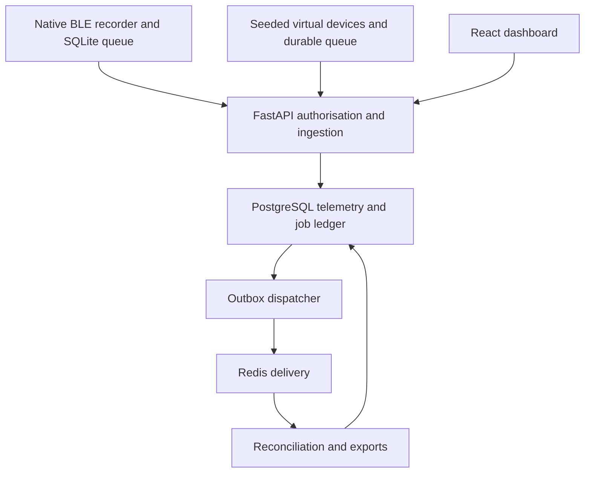
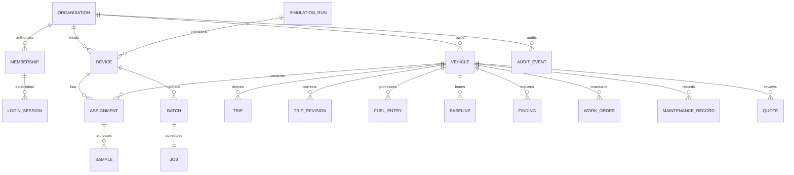

# Architecture and invariants

## Runtime

The backend is a modular monolith: identity, telemetry, trips, intelligence, fleet and advisor share a relational source of truth and explicit service boundaries. Sync SQLAlchemy sessions belong to one request or worker transaction. Request dependencies commit before the HTTP response is sent. An accepted upload and its required job are committed together.

Redis is a delivery hint. The durable ledger recovers publication failures and expired leases; the local developer worker polls this same ledger. Worker results and completion are committed atomically. Simulation generation and reset use a run lock and generation fencing. Vehicle locks serialize ingestion and reconciliation. A stale broker delivery cannot revive a reset run.

Device credentials determine tenant, origin and collector identity. Assignment intervals validate observation time; request fields cannot select another tenant. A batch hash detects changed idempotency payloads; device/session/sequence identity also prevents repackaged duplicate samples. Acknowledgement means committed storage, not finished trip calculation.

## Logical ER diagram

The diagram shows logical relationships. The migrations define exact foreign keys and indexes. Composite vehicle/tenant and assignment/device/tenant foreign keys prevent cross-tenant joins. PostgreSQL forces row-level security on business tables. Authentication registries are outside RLS so credentials can establish the context; every business request revalidates active membership. The runtime database role must be a non-owner without BYPASSRLS. SQLite tests exercise application policies, not RLS.

## Decisions

1. **Native collection owns continuity.** SQLite queues, polling, reconnects and upload acknowledgement live in Swift/Kotlin. React renders snapshots and controls explicit start/stop. No JavaScript background timer claims to maintain BLE recording. Native binary and physical lifecycle validation are pending.
2. **Explicit origin.** `REAL` and `SIMULATED` remain distinct through storage, trips, findings, advisor and CSV. A simulation has a seed, scenario version, virtual clock and generation. Real devices use server time with bounded skew/retention.
3. **Conservative trips.** Movement must persist; RPM zero cannot end a trip. Engine-off movement and stop-start traffic remain journeys. Missing end evidence is uncertain. Explicit user stop is distinct from proven parking. Local state is provisional; Python reconciliation is authoritative.
4. **Coverage before efficiency.** Integrals exclude gaps over 15 seconds. Supported ECU fuel rate, qualified counters and qualified petrol MAF estimates retain their method. Purchases are separate. Efficiency is a ratio of sums for fully covered sessions, and excluded-session count is reported. Insufficient paired coverage returns null.
5. **Interpretable evidence.** The first production path is a warm-idle fuel-compensation trend with a frozen reference and persistent recent residual. Its evidence is immutable per baseline episode. It offers an inspection suggestion, not a component diagnosis. Other advanced detectors are not implied by an empty alert list.
6. **Explicit mutations.** The advisor prepares an expiring pending action. Confirmation rechecks actor, membership, role, vehicle version and evidence. Quotes require user verification; document text never invokes tools. The default is deterministic and labelled; the optional model-client interface is not active.
7. **Bounded prototype.** Uploads have a 1 MB/1000-sample limit. Reconciliation stops explicitly above 100,000 retained samples per vehicle. Large-scale incremental projections and production capacity remain work; silent truncation is not used for reconciliation.
8. **Generated contracts.** Canonical Pydantic v1 wire fields use camelCase; unknown fields and nonfinite values are rejected. Generated OpenAPI/TypeScript changes are checked in CI. Shared JSON trip fixtures are consumed by Python and compiler-based native checks.
